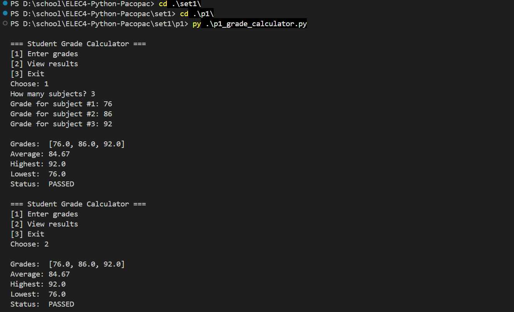
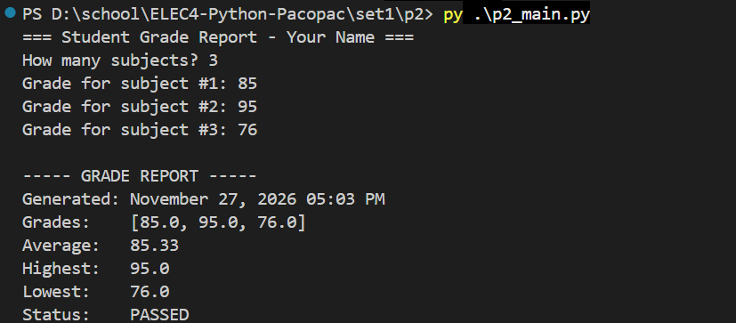
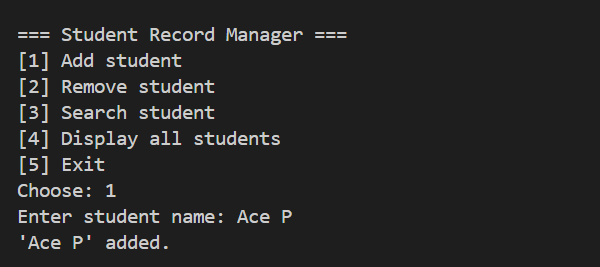
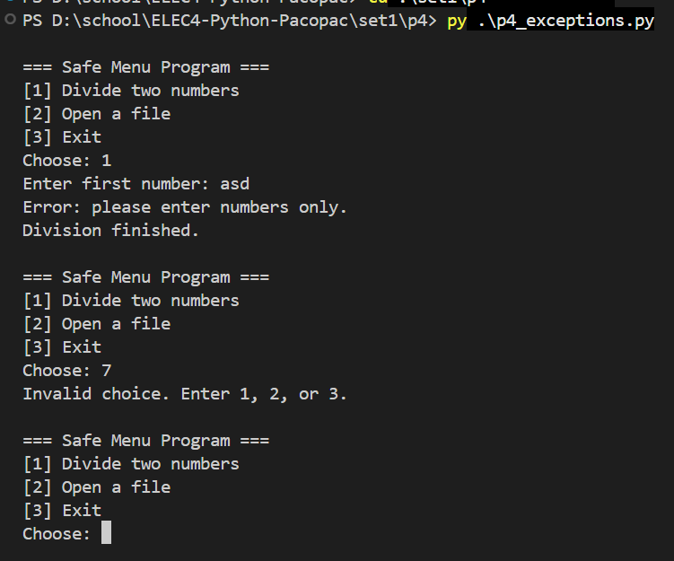

# ELEC 4 – Python Programming

**Name:** Pacopac, Ace M.
**Section:** IV-BSIT A
**Course:** ELEC 4 – Python Programming

---

## Repository Description

This repository holds my Python activities for the ELEC 4 self-paced assignment. Each activity has its own folder with the source code and screenshots of the program running.

---

## Set 1 – Python Fundamentals

| Activity | Description | Folder |
| --- | --- | --- |
| P1 – Student Grade Calculator | Menu program that reads subject grades, validates them (0–100), and shows the average, highest, lowest, and pass/fail status using user-defined functions. | [Open P1](set1/p1) |
| P2 – Custom Module: student_utils | A reusable module with grade functions, imported by a main program using both import styles plus the built-in `datetime` module. | [Open P2](set1/p2) |
| P3 – Student Record Manager | Menu program to add, remove, search, and display students, using a list for display/search and a set to block duplicate names. | [Open P3](set1/p3) |
| P4 – Safe Menu Program | Menu program that divides numbers and opens files safely using `try`, `except`, `else`, and `finally`. | [Open P4](set1/p4) |

---

## How to Run the Activities

1. Install Python 3 and Git.
2. Clone this repository:
   ```bash
   git clone https://github.com/YOUR-USERNAME/ELEC4-Python-Pacopac.git
   ```
3. Go into the repository folder:
   ```bash
   cd ELEC4-Python-Surname
   ```
4. Make sure you are on `main` (merged sets) or switch to a set branch:
   ```bash
   git switch main
   ```
5. Run an activity using the commands below (use `python3` instead of `python` on macOS).

**Set 1 commands:**

```bash
# P1 - Student Grade Calculator
python set1/p1/p1_grade_calculator.py

# P2 - Custom Module (main program)
python set1/p2/p2_main.py

# P2 - Module self-test (optional)
python set1/p2/student_utils.py

# P3 - Student Record Manager
python set1/p3/p3_record_manager.py

# P4 - Safe Menu Program
cd set1/p4
python p4_exceptions.py
```

**Note:** P4 must be run from inside its own folder so it can find `sample.txt`. Keep any data files in the same folder as the activity that uses them.

---

## Screenshots

### P1 – Student Grade Calculator


### P2 – Custom Module: student_utils


### P3 – Student Record Manager


### P4 – Safe Menu Program


---

## Technologies Used

- Python 3
- Built-in modules: `datetime`
- Git and GitHub (branches, commits, pull requests)
- Visual Studio Code

---

**Submitted by:** Pacopac, Ace M.
**Section:** IV-BSIT A